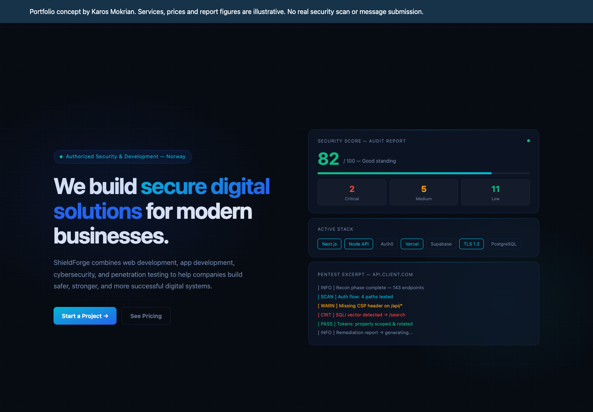

# ShieldForge – frontendkonsept for en sikkerhetsnettside

Et designkonsept som utforsker hvordan en sikkerhetstjeneste kan presenteres: layout, navigasjon, typografi og visuell vektlegging av tjenester.



> Fiktivt byråkonsept. Tjenester, priser og tall er illustrasjoner. Siden skanner ingenting, selger ingenting og sender ingen skjemaer. Navnet er brukt som fiktivt merkenavn i et designprosjekt og har ingen tilknytning til en eksisterende virksomhet.

## Hva den viser

- Toppseksjon med tydelig posisjonering
- Tjenestesektioner med nummerert hierarki
- Pris- og pakkeoppsett
- Kontaktseksjon med demo-skjema
- Animasjoner og overganger som tåler redusert bevegelse
- Responsivt oppsett

Begge skjemaene på siden er endret til å si eksplisitt at ingenting sendes. En udokumentert sertifiseringspåstand er fjernet fra innholdet.

## Teknisk

| | |
|---|---|
| Rammeverk | Next.js 14 (App Router) |
| Språk | TypeScript, React 18 |
| Styling | Tailwind CSS |
| UI | Radix UI, Framer Motion, Lucide |

## Kom i gang

```sh
npm install
npm run dev
```

Åpne adressen Next.js skriver ut (vanligvis <http://localhost:3000>).

```sh
npm run build   # produksjonsbygg med typekontroll
```

## Testing

Produksjonsbygg med typekontroll er kjørt uten feil. Nettlesertest av konseptmerknaden og kontaktdemoen er gjennomført. Detaljer i [`VERIFISERING.md`](VERIFISERING.md).

## Begrensninger

Avhengighetene er beholdt slik de sto i kilden og er **ikke** oppgradert eller sårbarhetsrevidert i denne publiseringen. Innholdet er illustrasjoner. Prosjektet er ikke ment som en operativ nettside for en sikkerhetstjeneste.

## Bakgrunn

Prosjektet inngår i Karos Mokrians portefølje og er utviklet med KI-assistanse. Beskrivelsene over gjelder det koden faktisk demonstrerer.

## Lisens

MIT for koden i dette repoet – se [LICENSE](LICENSE). Tredjepartsbiblioteker beholder egne vilkår.
